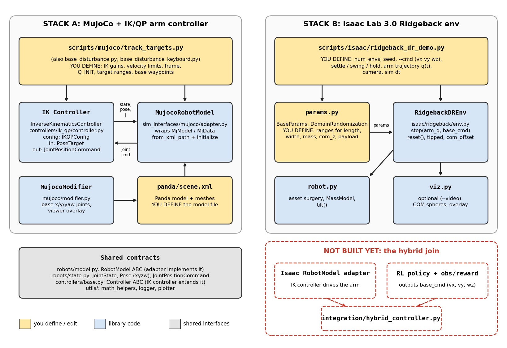

# Code overview: what is used where, and what you need to define

The repo currently holds **two stacks that do not import each other yet**:

| Stack | Purpose | Simulator | Status |
|---|---|---|---|
| **A. MuJoCo + IK/QP** | 7-DoF Panda arm tracking world-frame poses, optionally on a moving base | MuJoCo | Complete, tested |
| **B. Isaac Ridgeback DR** | Free-base Ridgeback-Franka with per-env randomized platform, tipping detection | Isaac Lab 3.0 | Complete as a simulation env; no controller attached |

The hybrid goal (RL base policy + IK/QP arm) is the join of A and B. That join (`integration/hybrid_controller.py`, an Isaac `RobotModel` adapter, the RL policy) does **not exist yet**.

---

## 1. Big picture



(Vector version: [figures/architecture.svg](figures/architecture.svg). Yellow boxes are what you edit or define.)

---

## 2. Stack A: MuJoCo + IK/QP

### Data flow in one control tick (what `track_targets.py` / `base_disturbance.py` do)

```
PoseTarget (world frame) ─┐
                          ▼
 robot.get_state()/get_pose()/get_jacobian()  ──►  InverseKinematicsController.compute(target, dt)
                                                      (QP on joint velocities, integrated to position)
                                                          │ JointPositionCommand
                                                          ▼
                                       robot.apply_command(cmd)  → writes data.ctrl only
                                       mujoco.mj_step(...)       → caller steps physics
                                       robot.apply_base_command(...)  (base slide/yaw servo, base_disturbance only)
```

### Files

| File | Role |
|---|---|
| `robots/model.py` | `RobotModel` ABC: `joint_names`, `position_limits`, `get_state`, `get_com_state`, `get_pose(frame)`, `get_jacobian(frame)`, `apply_command`. The only thing a controller knows about the simulator. |
| `robots/state.py` | Validated dataclasses `JointState`, `CenterOfMassState`, `Pose` (xyzw), `JointPositionCommand`. |
| `controllers/base.py` | `Controller[TargetT, CommandT]` ABC: `compute(target, dt)`, `reset()`. |
| `controllers/ik_qp/ik_qp_mujoco.py` | `InverseKinematicsController(robot, IKQPConfig)`; inputs `PoseTarget`, outputs `JointPositionCommand`. |
| `sim_interfaces/mujoco/adapter.py` | `MujocoRobotModel`: `from_xml_path(...)` + `initialize(...)`; maps joints to actuators; also `apply_base_command`. |
| `sim_interfaces/mujoco/modifier.py` | `MujocoModifier.build_mobile_base_spec(...)` adds x/y/yaw slide joints under link0; `update_overlay(...)` draws COM + target frames in the viewer. |
| `sim_interfaces/mujoco/models/panda/` | Panda XML + meshes (`scene.xml` is the entry point). |
| `utils/math_helpers.py`, `logger.py`, `plotter.py` | Quaternion/kinematics helpers, logging, plots. |

### What you define (all at the top of the experiment script)

Edit the constants in `scripts/mujoco/track_targets.py` or `base_disturbance.py`:

| What | Constant(s) |
|---|---|
| Model file | `XML_FILE` |
| Joints ↔ actuators | `JOINT_ACTUATOR_PAIRS` |
| Controlled frame | `FRAME_CONTROL` (e.g. `"grasp"`) |
| IK tuning (→ `IKQPConfig`) | `KP_POS`, `KP_ORI`, `POSITION_WEIGHT`, `ORIENTATION_WEIGHT`, `JOINT_VEL_WEIGHT`, `DQ_MIN/DQ_MAX` |
| Control rate / duration | `DT_CTRL`, `TRACKING_SECONDS` |
| Initial pose | `Q_INIT`, `FINGER_POSITION_INIT`, `GRIPPER_COMMAND_INIT` |
| Targets | `TARGET_RADIUS`, `ROTATION_ORDER`, `ORIENTATION_CENTER_DEG`, `ORIENTATION_RANGE_DEG`, `N_TARGETS` |
| Base disturbance (base_disturbance only) | `BASE_MOTION_RADIUS`, `BASE_YAW_RADIUS`, `N_BASE_POSITIONS`, `BASE_SERVO_KP`, `BASE_YAW_SERVO_KP`, `BASE_RANGE` |
| Viewer | `SHOW_VIEWER`, `COM_MARKER_DIAMETER` |

`base_disturbance_keyboard.py` is the interactive variant (move the base by keyboard). `tests/test_model_controller.py` exercises the adapter + controller contract.

To plug in a **new controller**: subclass `Controller[Target, Command]`, implement `compute`/`reset`, only use the `RobotModel` API.
To plug in a **new simulator**: subclass `RobotModel` (Isaac adapter is the planned one), honouring the conventions in `CLAUDE.md` (xyzw quats, `(6, n)` Jacobian, no stepping inside reads).

---

## 3. Stack B: Isaac Ridgeback domain randomization

### Data flow in the demo (`ridgeback_dr_demo.py`)

```
DomainRandomization().sample_many(N, seed)  ──►  list[BaseParams]            (params.py)
                         │
                         ▼
RidgebackDREnv(params, sim, spacing, num_cols, friction, tau, max_force)     (env.py)
   ├─ spawns N robots at /World/envs/env_i/Robot       ← build_robot_cfg()          (robot.py)
   ├─ per env: deactivate dummy joints, resize footprint,
   │           low-friction material, translucent box   ← free_and_resize_base()    (robot.py)
   env.start()  → sim.reset(), then MassModel.set_params(params)  (base mass, COM z, box inertia, payload at TCP)
                         │
                         ▼
loop:  env.step(arm_q_target (N,7), base_cmd (N,3) = vx, vy, wz)
          ├─ arm: position targets on panda_joint1..7
          ├─ base: first-order velocity tracker → planar force + yaw torque on base_link (off once tipped)
          └─ _update_state(): roll/pitch/yaw, platform/arm/total COM, com_offset, `tipped`, `left_footprint`
```

Readable state after each step: `env.tipped`, `env.left_footprint`, `env.com_offset`, `env.com_total/com_arm/com_platform`, `env.roll/pitch/yaw`, `env.base_pos` (env-local), `env.mass_total`, `env.time`. Pre-computed arm poses: `env.q_fold` (default), `env.q_stretched`.

### Files

| File | Role | Needs Kit running? |
|---|---|---|
| `isaac/ridgeback/params.py` | `BaseParams` (footprint, base_mass, base_com_z, payload) and `DomainRandomization` (uniform ranges + `sample`/`sample_many`). | No (tested in `tests/test_ridgeback_params.py`) |
| `isaac/ridgeback/robot.py` | Asset surgery: `build_robot_cfg`, `free_and_resize_base`, `MassModel`, `tilt`; geometry constants (`MOUNT_X`, `STOCK_HEIGHT`, `TCP_Z`, `Q_STRETCHED`, ...). | Yes (import only after launcher args are parsed) |
| `isaac/ridgeback/env.py` | `RidgebackDREnv`: scene layout, step, reset, tipping logic, `TIP_ANGLE`. | Yes |
| `isaac/ridgeback/viz.py` | `ComMarkers`, `project`, `overlay` for video. | Yes |

### Scripts

| Script | What it is |
|---|---|
| `scripts/isaac/ridgeback_dr_demo.py` | **Main entry**: N randomized envs, settle → swing arm → hold, reports which tipped. Uses `RidgebackDREnv`. |
| `scripts/isaac/ridgeback_tipping_demo.py` | Single-robot tipping experiment with named `CASES` (self-contained, predates the package). |
| `scripts/isaac/ridgeback_demo.py` | Stock robot with a fixed base: drive schedule + arm/gripper motion (self-contained). |
| `scripts/isaac/ridgeback_base_probe.py` | Probe for changing base mass / robot mass / platform size (self-contained). |

### What you define

| What | Where |
|---|---|
| Randomization ranges | `DomainRandomization` fields in `params.py` (`length`, `width`, `base_mass`, `base_com_z`, `payload`), or pass your own instance |
| Fixed per-env params | construct `BaseParams(...)` directly and pass a list to `RidgebackDREnv` |
| Number of envs, layout, seed | CLI: `--num_envs`, `--num_cols`, `--spacing`, `--seed` |
| Physics step | `SimulationCfg(dt=1/120)` in the demo's `main()` |
| Base actuator model | `RidgebackDREnv(tau=..., max_force=..., friction=...)` |
| Tip threshold | `TIP_ANGLE` in `env.py` |
| Arm motion | In the demo loop: the `q` you pass to `env.step` (currently a smoothstep from `q_fold` to `q_stretched`) |
| Base motion | The `base_cmd` you pass to `env.step` (CLI `--cmd VX VY WZ` in the demo). **This is the slot the RL policy will fill.** |
| Scenario timing | `--settle`, `--swing`, `--hold` |
| Video | `--video`, `--video_path`, `--video_fps`; camera constants `CAM_EYE`, `CAM_TARGET`, `FOCAL`, `RES` in the demo |

Run command (from the Isaac Lab folder), see the script docstring:
`PYTHONPATH=~/hybrid-rl-mpc-control/src uv run --extra isaacsim --extra video python ~/hybrid-rl-mpc-control/scripts/isaac/ridgeback_dr_demo.py --num_envs 8 --seed 0 --video`

### Gotchas

- Import `robot.py` / `env.py` / `viz.py` only inside the `launch_simulation` context (they import `isaaclab.sim` / `pxr`); `params.py` is safe anywhere.
- Footprint is baked into the USD at spawn, so it cannot change at reset. Mass, COM height and payload can (`MassModel.set_params`, which is non-accumulating).
- Isaac Lab 3.0 quaternions are **xyzw**, matching the repo convention.
- Failure criterion is "total COM leaves the footprint" (`left_footprint`); `tipped` latches on roll/pitch > `TIP_ANGLE`. Both are cleared by `env.reset()`.

---

## 4. RL training pipeline (base policy + IK/QP arm)

Quick commands to train, watch and evaluate: [training_cheatsheet.md](training_cheatsheet.md).

The RL base policy trains in `RidgebackDREnv` with the existing IK/QP controller driving the arm in the loop.

```
RidgebackDREnv (batched, DR)  <--  BaseStabilizationEnv (rl/env.py, RSL-RL VecEnv)  <--  OnPolicyRunner (PPO)
   per-env partial reset            policy action (vx, vy, wz) held for `decimation` physics steps
   dynamics re-sampled at reset     every `ik_every` steps: one InverseKinematicsController.compute per env, solved in
                                    parallel worker processes (rl/qp_pool.py); ArmBatch/IsaacArmModel = RobotModel view
                                    of each env's arm, world frame
```

| File | Role |
|---|---|
| `rl/env.py` | `BaseStabilizationEnv` + `StabilizationEnvCfg`/`IKCfg`: decimation, QP loop, resets, logging |
| `rl/qp_pool.py`, `rl/qp_worker.py` | Worker-process pool for the per-env QPs (shared memory; same controller, same results) |
| `rl/observations.py` | `observe(Snapshot)` -> actor/critic obs (base frame, reference lookahead, total COM, params) |
| `rl/rewards.py` | `RewardCfg`, `compute_rewards`: COM centred, near/toward the trajectory, motion penalties, termination |
| `rl/policy_with_controller/trajectories.py` | World-frame random reference pose trajectories: fixed points + Lissajous (reachable from the spawn pose) and quintic spawn → A → B pose paths (exact shell/height checks) |
| `rl/config.py` | RSL-RL PPO runner config (dict) |
| `isaac/ridgeback/arm_model.py` | `ArmBatch` (one GPU->CPU snapshot per QP tick) and `IsaacArmModel(RobotModel)` per env |
| `isaac/ridgeback/viz.py` | COM markers (arm, total + plate projection), reference lookahead markers (policy lookahead times, yellow now -> green ahead), overlays |
| `scripts/isaac/train_base_policy.py` | Training entry point; TensorBoard logs in `<repo>/logs/base_policy/<run>/` |
| `scripts/isaac/play_base_policy.py` | Deterministic evaluation (failures, COM offset, base-motion statistics; `--zero_policy` baseline) |
| `scripts/isaac/compare_policies_video.py` | Side-by-side video of two checkpoints on identical scenarios, with live CoM-offset bars |
| `scripts/isaac/record_episodes_video.py` | One video of several completely different episodes (own platform each) for one checkpoint; `--mode sampled` shows an untrained policy with exploration noise |
| `scripts/isaac/check_stabilization_env.py` | Integration checks: Jacobian, static-base QP tracking, partial reset, throughput |
| `scripts/plot_reference_trajectories.py` | Plot of sampled reference trajectories with the arm's reach limits |

Design decisions worth knowing:

- **The QP is unaware of the base.** Targets are world-frame, so base motion appears as tracking error that the QP corrects.
- **Every reference is reachable from the spawn pose** (within 0.78 m of the shoulder, outside 0.30 m, above 0.35 m, directions +-150 degrees around forward: 49/51% left/right, 61/39% in front/behind), so the QP alone can track it; the base only has to keep the platform stable.
- **Reward:** CoM centred over the footprint (main term), tilt penalty, termination penalty; closeness to the trajectory centre plus potential-based progress toward it (no reward for circling); a modest end-effector tracking term (the QP tracks, but the base can disturb it), and penalties on measured base speed, yaw rate, yaw drift and jerky actions so corrections are slow and smooth. Weights are in `RewardCfg`; every term is logged as `Episode_Reward/<term>`.
- **Arm gravity compensation is on** (`StabilizationEnvCfg.gravity_compensation`): the Isaac arm is a PD actuator (stiffness 800) and sags under gravity (~0.13 m error); the real Franka compensates gravity internally.
- **QP gain 25/s** (`IKCfg.kp_pos`): the QP is P-only, so a moving reference lags by speed / gain.
- **Position-only QP task by default** (`IKCfg.track_orientation=False`): the QP weights only scale the desired twist, not the Jacobian rows, so any orientation row constrains the arm even at weight 0; the adapter zeroes the angular rows.
- **Domain randomization is skewed to hard cases** (`DomainRandomization.hard_bias`): small, light platforms and heavy payloads; platform COM height is fixed. With these settings a static base (zero command) fails about 59% of episodes (measured), the trained policy about 0.5%. The footprint is fixed per env slot (baked into the USD at spawn); mass and payload are re-sampled at every reset.
- **Rendering quirk:** in the video setups one robot's mesh (the first one in a view) is sometimes not drawn although its physics and COM markers are fine; cause not found. `compare_policies_video.py` puts an unused dummy env at index 0 and does not rely on a particular env.

Run (from the Isaac Lab folder):
`PYTHONPATH=~/hybrid-rl-mpc-control/src .venv/bin/python ~/hybrid-rl-mpc-control/scripts/isaac/train_base_policy.py --num_envs 256 --qp_workers 48 --max_iterations 300`
and `.venv/bin/tensorboard --logdir ~/hybrid-rl-mpc-control/logs/base_policy` for the logs.

---

## 5. Still missing

1. **Arm compensation for base motion in the hybrid demo** (`integration/hybrid_controller.py`): load a trained policy and run it with the QP outside the training wrapper.
2. **Larger/faster training**: more envs, automatic difficulty/DR curriculum.
3. **Sim-to-real extras**: observation noise, actuator randomization.
